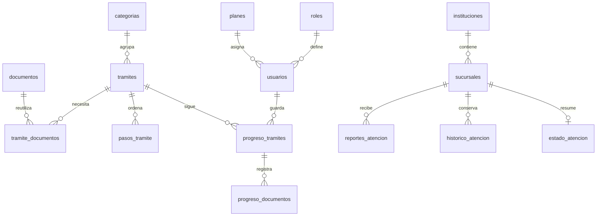

# Base de datos de DIRI

`diri.sql` instala el esquema actual: **40 tablas, 2 vistas SQL y 17 triggers**, InnoDB, `utf8mb4_unicode_ci`, claves foráneas, índices y restricciones `CHECK`. La migración 009 elimina dependencias parciales de cinco relaciones e incorpora el catálogo compartido `palabras_clave`. Véase [normalización en 3FN](../docs/normalizacion-3fn.md). Comprobado en MariaDB 10.4.32 de XAMPP; no se ha ejecutado contra MySQL.

## Instalación

La base `diri` ya se instaló en este entorno. **No vuelvas a importar el archivo sobre ella.** No es un actualizador ni una copia de seguridad.

Para una instalación nueva, revisa primero que no exista una base `diri`. Desde PowerShell y con MariaDB iniciado:

```powershell
# Acceso local actual de XAMPP. Usa tu usuario y -p si tiene contraseña.
& 'C:\xampp\mysql\bin\mysql.exe' --default-character-set=utf8mb4 --abort-source-on-error -h 127.0.0.1 -u root -e "SOURCE C:/xampp/htdocs/DIRI/database/diri.sql;"
```

También puede importarse mediante la opción Importar de phpMyAdmin, conservando la interrupción ante errores. El archivo incluye `CREATE DATABASE diri` y `USE diri`.

No contiene `DROP`, `TRUNCATE`, desactivación de claves foráneas ni reemplazo de datos. Si la base ya existe, `CREATE DATABASE` falla. La herramienta de importación debe detenerse ahí: no uses `--force` ni continúes manualmente después de un error. Los cambios futuros se harán con migraciones independientes, después de revisar el estado existente.

Las instrucciones DDL de MariaDB no son una única transacción reversible. Si una instalación nueva se interrumpe, revisa qué se creó antes de intentar continuar. Las semillas se insertan dentro de una transacción.

## Datos iniciales

| Datos | Cantidad | Alcance |
|---|---:|---|
| Roles | 2 | administrador y usuario |
| Planes | 2 | free y premium, sin cobros ni control de prestaciones todavía |
| Categorías | 6 | Organización editorial interna |
| Fuente | 1 | Catálogo preparatorio de DIRI, sin verificación oficial |
| Trámites | 20 | Títulos en borrador, pendientes de verificación |
| Versiones de esquema | 2 | `003_inicial` y `007_revision_contenido` |

No se crean usuarios, contraseñas predeterminadas, precios, requisitos, pasos, horarios, sucursales ni integraciones. Los títulos generales, como «Apertura de negocio» o «Trámites municipales», son entradas editoriales por desarrollar: no afirman que exista un único procedimiento con ese nombre. Antes de publicarlos deberá delimitarse actividad, municipio y alcance.

## Tablas y responsabilidades

| Área | Tablas |
|---|---|
| Identidad | `roles`, `planes`, `usuarios` |
| Catálogo | `categorias`, `tramites`, `requisitos`, `documentos`, `tramite_documentos` |
| Búsqueda futura | `etiquetas`, `tramite_etiquetas`, `palabras_clave_tramite` |
| Instituciones y disponibilidad | `instituciones`, `sucursales`, `horarios`, `excepciones_horario`, `tramite_sucursales` |
| Procedimientos | `pasos_tramite`, `paso_documentos`, `paso_dependencias` |
| Costos y evidencia | `costos`, `paso_costos`, `fuentes`, `tramite_fuentes` |
| Rutas compuestas | `rutas`, `ruta_tramites`, `ruta_dependencias` |
| Actividad personal | `favoritos`, `progreso_tramites`, `progreso_documentos`, `progreso_pasos`, `rutas_guardadas`, `historial_busquedas` |
| Atención | `reportes_atencion`, `historico_atencion`, `estado_atencion` |
| Integraciones | `integraciones_api`, `integracion_ejecuciones` |
| Control interno | `auditoria_administrativa`, `versiones_esquema` |

La definición completa de campos, tipos, índices y restricciones está en `diri.sql`. El orden de creación sigue las dependencias: las tablas referenciadas se crean primero.

## Relaciones principales



Las tablas puente representan relaciones de muchos a muchos. `tramite_sucursales` indica qué oficina atiende cada trámite. `ruta_tramites` permite combinar varios trámites para un objetivo, mientras `pasos_tramite` describe el procedimiento de uno solo.

`paso_costos` admite varios conceptos por paso. Los horarios semanales se guardan en `horarios`, sin duplicar una cadena de horario en `sucursales`. Se pueden registrar varios turnos en un mismo día. `excepciones_horario` admite cierre o un turno especial por sucursal y fecha; ampliar a varios turnos excepcionales requerirá una migración si se necesita.

## Integridad y decisiones de diseño

- Email, slug y parejas de favoritos son únicos. Cada usuario tiene un seguimiento por trámite y cada sucursal un estado de atención actual.
- Las FK y los triggers impiden relacionar un seguimiento con documentos o pasos de otro trámite, o mezclar costos y pasos. Las relaciones normalizadas obtienen el trámite desde su padre. Las FK compuestas conservadas controlan dependencias de rutas y reportes de sucursales diferentes.
- `NULL` significa desconocido. Un costo desconocido no se presenta como gratuito. Las coordenadas son ambas conocidas o ambas desconocidas.
- Los montos usan `DECIMAL(12,2)`. Los tiempos numéricos se expresan en minutos y las cantidades son no negativas.
- Los datos verificados de trámites, requisitos y costos requieren fuente y fecha. Un costo verificado requiere además monto.
- `fuente_id` en `tramites` es la fuente principal. `tramite_fuentes` permite evidencia complementaria y observaciones específicas.
- El SQL impide autodependencias. La detección de ciclos de varios pasos, el orden coherente y los solapamientos de horarios se validarán en los servicios de fases posteriores.
- Las restricciones no acreditan que una fuente sea realmente oficial. El CRUD de la fase 6 exige fuente y clasificación para publicar, además de fuente oficial y fecha para marcar verificado. La revisión real de la evidencia sigue a cargo del administrador.
- Las entidades con historial se desactivarán. Sus relaciones usan `RESTRICT` por defecto. Solo algunas relaciones personales o auxiliares permiten eliminación en cascada.
- La base almacena hashes de contraseña. La fase 4 aplica validación, `password_hash()` y `password_verify()` desde la aplicación. No existe una cuenta administrativa predeterminada.
- Rol, plan y estado de revisión son estructura de datos. Las autorizaciones y controles por plan todavía no están implementados.

## Fechas y fuentes de atención

Las conexiones PDO y el importador establecen la sesión en UTC para las marcas internas `DATETIME` (registro, actualización, vigencia y ejecución). El código que envíe estas fechas debe convertirlas a UTC. Las vistas futuras convertirán UTC a `America/La_Paz` para mostrarlas.

Los horarios de oficina y los pares `fecha`/`hora` de observaciones ciudadanas e históricas representan hora local de Bolivia. La fecha de verificación es una fecha editorial, no una marca de recepción.

En atención, `fuente` clasifica el origen (`OFICIAL_API`, `DIRI_USUARIOS`, `ADMINISTRADOR`, `ESTIMACION`), mientras `fuente_id` permite asociar evidencia. `estado_atencion` distingue el tiempo comunicado por una fuente del intervalo calculado por DIRI. Incluye confianza, cantidad de observaciones y vencimiento. Ninguna fila de atención se crea con las semillas.

`integraciones_api` empieza vacío. Guardará referencias a credenciales privadas, nunca tokens. Los campos de respuesta y auditoría son resúmenes: los servicios futuros deben excluir contraseñas y datos privados. Esta fase no consulta APIs ni calcula esperas.

## Comprobaciones

```powershell
& 'C:\xampp\php\php.exe' scripts/check-database.php
& 'C:\xampp\php\php.exe' tests/database-connection.php
& 'C:\xampp\php\php.exe' tests/database-schema.php
```

La última prueba crea filas temporales dentro de una transacción, comprueba restricciones y hace `ROLLBACK` incluso si falla. Puede dejar saltos en los contadores `AUTO_INCREMENT`, lo cual es normal. No modifica los borradores iniciales ni conserva usuarios o instituciones de prueba.

La prueba de esquema necesita permisos de lectura, inserción, actualización y eliminación en una base local de desarrollo. No ejecutes estos comandos contra producción.

## Próxima fase

La fase 4 incorpora registro, login y logout sin cambiar este esquema. Consulta [la documentación de autenticación](../docs/authentication.md). Las pantallas del catálogo se implementarán en fases posteriores.

## Actualización de la fase 7

La gestión de requisitos y documentos utiliza las tablas existentes y añade `tramites.revision` para controlar cambios de contenido. El instalador nuevo ya lo incluye. Para bases de fases anteriores, ejecuta `scripts/migrate-content.php`; no reimportes `diri.sql`. Consulta [la documentación de contenido](../docs/requisitos-documentos.md). Esa fase conservó 39 tablas; la normalización posterior incorpora una tabla compartida de palabras clave, para un total actual de 40.

